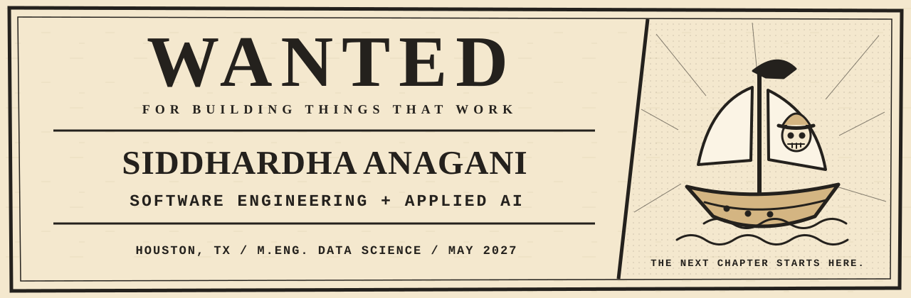

  

<h1 align="center">Siddhardha Anagani</h1>

<strong>Software engineer building backend systems, native apps, and applied AI.</strong> Seeking software engineering internships and AI/ML opportunities.

  <a href="mailto:sidsidsid328@gmail.com">Email</a> &nbsp; / &nbsp;
  <a href="https://linkedin.com/in/siddhardha-anagani">LinkedIn</a> &nbsp; / &nbsp;
  <a href="https://siddhardhaanagani69-ship-it.github.io/">Portfolio</a> &nbsp; / &nbsp;
  <a href="#the-project-log">Projects</a>

## The captain's log

I'm a **Data Science master's student at the University of Houston**, graduating in **May 2027**, and a Teaching Assistant supporting about **250 students across three courses**. Previously, I built software for UH's College of Medicine and deployed computer-vision systems at Vsigma IT Labs.

I like the part where a prototype meets real users: debugging production issues, testing the edges, and making the next release better.

| In the field | What changed |
| :--- | :--- |
| **Software people use** | Built a Flask/PostgreSQL time clock for **30 faculty and students across 3 classes**, with login, audit logs, Excel export, and daily sync. |
| **Cleaner institutional data** | Improved record-matching accuracy from **70% to 95-96%** with a Python/RapidFuzz pipeline. |
| **Vision in production** | Developed and deployed factory safety detection across **30+ live camera feeds**, then resolved onsite reliability issues. |

## The project log

### [Mahokshahvata](https://github.com/siddhardhaanagani69-ship-it/Mahokshahvata)
**From one VM to Kubernetes.**

A stock-analysis and **paper-trading** platform built in a team of two. It ranks **3,000 US stocks** by momentum, scores news with Claude, and runs a rules-based autopilot. All trading is simulated.

- FastAPI backend with PostgreSQL, Docker images, and GitHub Actions CI/CD.
- **2-4 autoscaled GKE replicas**, HTTPS load balancing, health checks, and rollback on deployment failure.
- A database lock ensures only one replica runs the trading scheduler.

`Python` `FastAPI` `Claude API` `PostgreSQL` `Docker` `GKE`

[Explore the platform and architecture →](https://github.com/siddhardhaanagani69-ship-it/Mahokshahvata)

---

### [SLM Training & Evaluation](https://github.com/siddhardhaanagani69-ship-it/slm-training-eval)
**Same model. Same token budget. Better training.**

A controlled experiment on a **30M-parameter language model** trained on TinyStories. Correcting the learning-rate schedule and update setup reduced validation perplexity by **55%: 17.84 to 7.98**, using the same **40M training tokens**.

Evaluated on the full validation split, with a unigram baseline and TinyStories-33M as a reference. The reference has a different model size and training budget, so it is not an equal-budget comparison.

`PyTorch` `Language modeling` `Training ablations` `Evaluation`

[Read the experiment and reproduce the results →](https://github.com/siddhardhaanagani69-ship-it/slm-training-eval)

---

### [Hinglish POS Evaluation](https://github.com/siddhardhaanagani69-ship-it/hinglish-pos-eval)
**How much of a model do you need to train?**

Part-of-speech tagging for code-mixed Hindi-English with HingRoBERTa. Adapters reached **89.86 macro-F1**, within **0.23 F1** of full fine-tuning while training **0.86% of the parameters**.

Compared configurations across three seeds, including a shuffled-feature control. Rule-based morphology helped the frozen encoder but added essentially nothing once adapters were trained.

`NLP` `HingRoBERTa` `Parameter-efficient tuning` `Controlled evaluation`

[Explore the evaluation and findings →](https://github.com/siddhardhaanagani69-ship-it/hinglish-pos-eval)

### Side voyages

| Project | What I built |
| :--- | :--- |
| [**Shift UI / Habits**](https://github.com/siddhardhaanagani69-ship-it/RetroHabits) | Native SwiftUI student assistant with a FastAPI backend. Combines Canvas, calendar, email, habits, and budget. The LLM parses schedule changes; a deterministic engine checks conflicts before the user accepts a plan. |
| [**Precedent**](https://github.com/siddhardhaanagani69-ship-it/Precedent) | A hackathon multi-agent decision council with retrieval, three debate rounds, and moderator evidence checks. Returns an explicit low-evidence result when retrieval cannot support a verdict. |

## What's in the toolkit

**Languages** &nbsp; Python · JavaScript · TypeScript · SQL · Swift · HTML/CSS  
**Backend & data** &nbsp; FastAPI · Flask · REST APIs · PostgreSQL · SQLAlchemy  
**Shipping & reliability** &nbsp; Docker · Linux · GitHub Actions · GKE · Debugging · Software documentation  
**Applied AI** &nbsp; PyTorch · YOLOv8 · OpenVINO · LLM workflows · RAG · Model evaluation  
**Native apps** &nbsp; SwiftUI

## Research & training

- **IEEE CONIT 2023:** *Black and White Image Colorization Using Convolutional Neural Networks* (peer-reviewed).
- **NVIDIA Deep Learning Institute:** Getting Started with Deep Learning (April 2026).
- **M.Eng. Data Science**, University of Houston, expected May 2027. **GPA: 3.5/4.0**.
- **B.Tech. Computer Science and Engineering**, Amrita Vishwa Vidyapeetham, 2024.

---

<strong>Every good voyage needs a crew.</strong> Looking for an intern who builds, debugs, documents, and follows through? <a href="mailto:sidsidsid328@gmail.com">Let's talk</a> · <a href="https://linkedin.com/in/siddhardha-anagani">Connect on LinkedIn</a>

Original fan-made manga artwork inspired by One Piece. Project results are documented in the linked repositories; experience details reflect my November 2026 resume.
