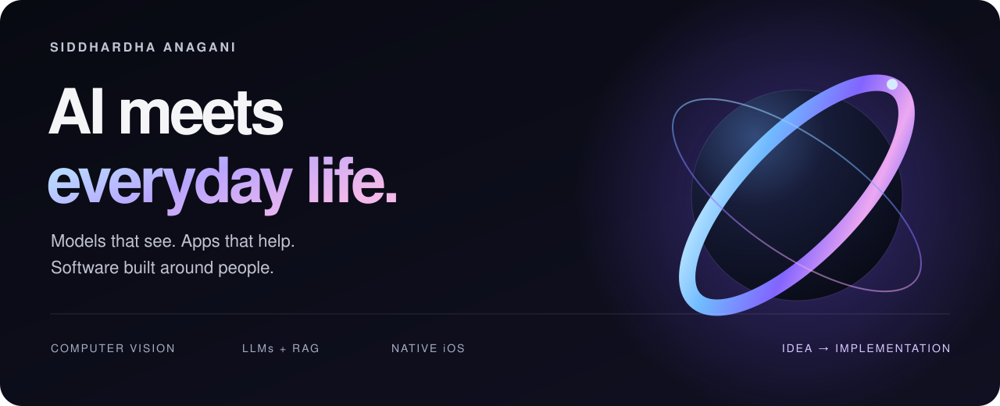

  

  <strong>Working toward AI engineering · M.Eng. Data Science at the University of Houston</strong>

  <a href="#selected-work">Explore my work</a> &nbsp;·&nbsp;
  <a href="https://linkedin.com/in/siddhardha-anagani">LinkedIn</a> &nbsp;·&nbsp;
  <a href="mailto:sanagani@cougarnet.uh.edu">Get in touch</a>

 

## A little context. A lot of building.

I build across **computer vision, LLM applications, and native iOS** — from detecting safety violations in factory camera feeds to turning everyday workflows into useful software. Currently going deeper on **RAG and reinforcement learning**, while working toward a full-time AI Engineer role.

| Vision at the edge | Research into practice | Tools people use |
| :--- | :--- | :--- |
| Real-time factory safety detection with **YOLOv8, Faster R-CNN & OpenVINO** | **1 published IEEE paper** and reinforcement-learning agent benchmarks | **Python + RapidFuzz** record matching and reporting used daily by UH College of Medicine analysts |

 

## Selected work

### 01 &nbsp; RxScanner
**From prescription label to clearer information.**

A SwiftUI project combining prescription-label scanning, OCR, and retrieval-augmented explanations.

**SwiftUI · OCR · RAG · LLMs**  
[Explore RxScanner ↗](https://github.com/siddhardhaanagani69-ship-it/RxScanner)

---

### 02 &nbsp; RetroHabits
**A more connected daily routine.**

A native habit and routine tracker bringing Canvas assignments and iPhone calendar events into one agenda, alongside habit streaks.

**SwiftUI · iOS · Calendar integration**  
[Explore RetroHabits ↗](https://github.com/siddhardhaanagani69-ship-it/RetroHabits)

---

### 03 &nbsp; Navigation
**Finding a way forward.**

Robot navigation and route-finding in Python.

**Python · Robotics · Route planning**  
[Explore Navigation ↗](https://github.com/siddhardhaanagani69-ship-it/navigation)

 

## What I work with

| Area | Tools & focus |
| :--- | :--- |
| **AI & vision** | Python, PyTorch, TensorFlow, OpenCV, YOLOv8, Faster R-CNN |
| **Deployment** | OpenVINO, NVIDIA DeepStream |
| **LLM systems** | LLM applications, retrieval-augmented generation |
| **Apps & data** | Swift, SwiftUI, TypeScript, SQL, RapidFuzz |

 

## Let's build something useful.

Interested in **AI Engineer opportunities** and conversations about computer vision, LLM applications, and applied AI.

[Email ↗](mailto:sanagani@cougarnet.uh.edu) &nbsp;·&nbsp; [LinkedIn ↗](https://linkedin.com/in/siddhardha-anagani)
